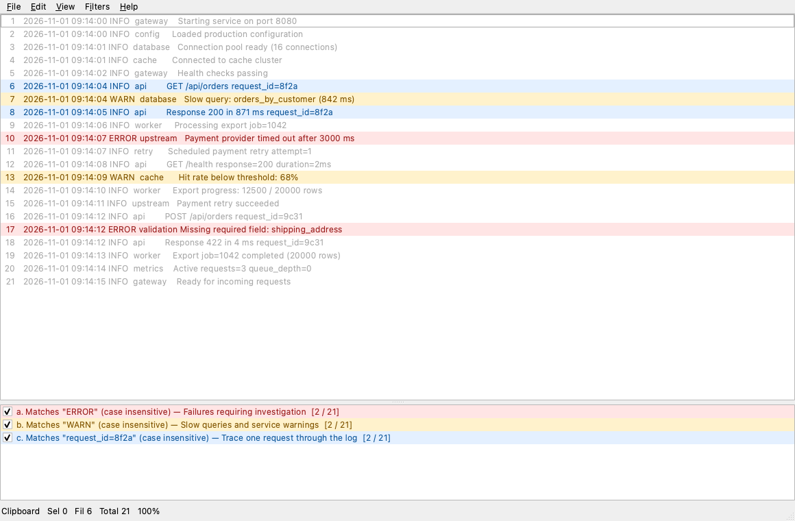

# TextScope

A cross-platform desktop viewer for filtering and navigating large text files,
inspired by TextAnalysisTool.NET. An independent implementation, not an official
port.

[User guide](docs/USER_GUIDE.md) |
[Developer guide](docs/DEVELOPER_GUIDE.md) |
[Release guide](docs/RELEASING.md) |
[Roadmap](docs/ROADMAP.md)



## Features

- Literal and regex filters with colored highlights and matching-lines-only views.
- Eight marker types, find, original-line navigation, and full-line copy/export.
- `.tat` filter sets and immutable snapshots that remain stable as source files change.

Regex uses PCRE2, not .NET; imported expressions may behave differently.
See the [user guide](docs/USER_GUIDE.md) for usage and limitations.

## Build

Requires CMake 3.25+, Ninja, a C++20 compiler, Qt 6.5+
(Widgets, Concurrent, Core5Compat and Test), and PCRE2's 16-bit development library.
See [platform setup](docs/DEVELOPER_GUIDE.md#dependencies-and-platform-setup)
for Linux and Windows UCRT64.

macOS:

```sh
brew install qt pcre2 cmake ninja pkg-config
```

Build and test from this project directory:

```sh
cmake -S . -B build -G Ninja -DCMAKE_BUILD_TYPE=Debug \
  -DTEXTSCOPE_BUILD_TESTS=ON -DTEXTSCOPE_BUILD_EXAMPLE_PLUGIN=ON
cmake --build build
ctest --test-dir build --output-on-failure
```

| Platform | Launch |
|---|---|
| macOS/Linux | `./build/tscope sample.log` |
| Windows UCRT64 | `./build/tscope.exe sample.log` |

`tscope` starts TextScope and returns to the terminal. The app/executable remains
named `textscope`; see [launcher usage](docs/USER_GUIDE.md#command-line).

For build options, focused tests and benchmarks, see the
[developer guide](docs/DEVELOPER_GUIDE.md). For packages and draft releases, see
the [release guide](docs/RELEASING.md).

## License

[MIT](LICENSE). Dependencies have their own
[license and distribution requirements](THIRD_PARTY_NOTICES.md).
