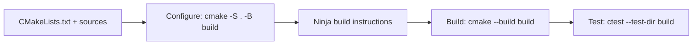
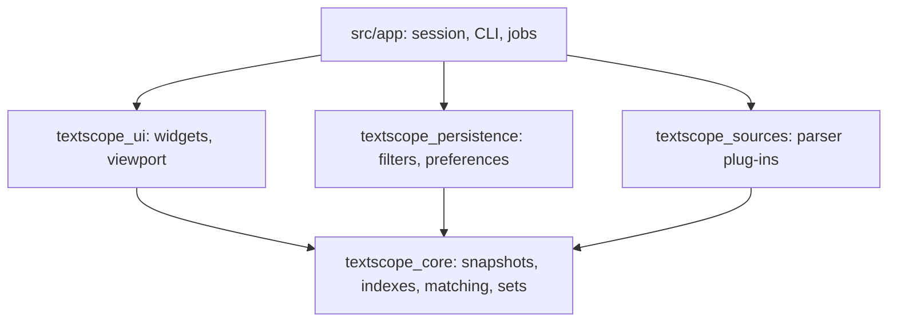
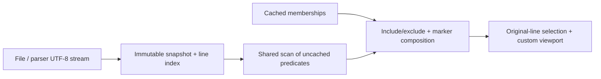
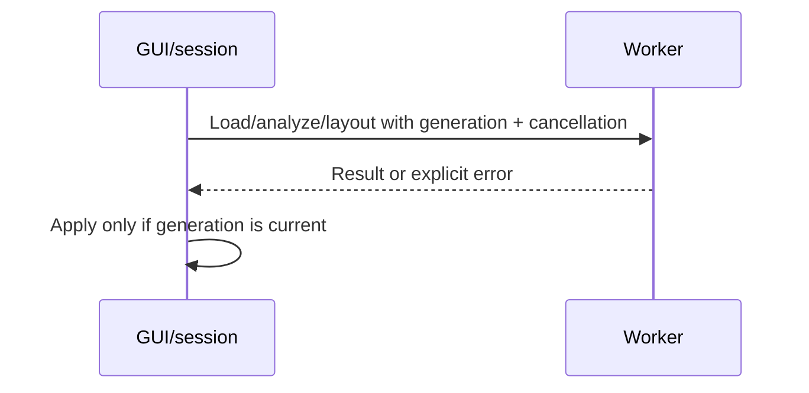
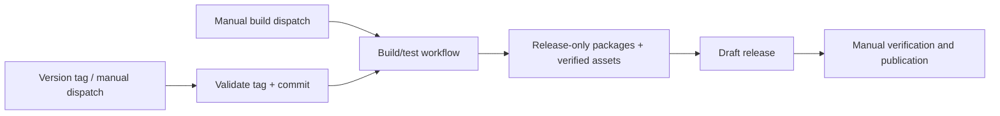

# TextScope developer guide

Build/test commands and engineering contracts. For application behavior, see the
[user guide](USER_GUIDE.md); for packaging/publication, see the
[release guide](RELEASING.md). Unimplemented work belongs in the [roadmap](ROADMAP.md).

## Dependencies and platform setup

Requires CMake 3.25+, Ninja, C++20, Qt 6.5+
(Core/Gui/Widgets/Concurrent/Core5Compat/Test), and PCRE2-16 development files.
PCRE2 discovery uses `PCRE2::16BIT` or pkg-config's `libpcre2-16`.

| Platform | Setup |
|---|---|
| macOS | `brew install qt pcre2 cmake ninja pkg-config` |
| Linux | Install CMake, Ninja, PCRE2 development files, Qt 6.5+ and `qt5compat` |
| Windows | MSYS2 **UCRT64** GCC, Qt and PCRE2 packages; no MSVC/vcpkg CI |

Ubuntu 24.04's default Qt is too old; CI installs Qt 6.8.3 separately:

```sh
sudo apt install cmake ninja-build libpcre2-dev
```

For a separate Qt installation, add
`-DCMAKE_PREFIX_PATH=/path/to/Qt/6.8.3/gcc_64` to configure.
Windows package/dependency commands are in the
[UCRT64 release reference](RELEASING.md#msys2-ucrt64).
Never mix dependency prefixes or reuse another compiler's build cache.

## Development (Debug)

Run from the TextScope project directory:

```sh
cmake -S . -B build -G Ninja -DCMAKE_BUILD_TYPE=Debug \
  -DTEXTSCOPE_BUILD_TESTS=ON -DTEXTSCOPE_BUILD_EXAMPLE_PLUGIN=ON
cmake --build build
ctest --test-dir build --output-on-failure
```



- `-S`: source directory; `-B`: build/cache directory; `-D`: configuration option.
- Use `build` with VS Code CMake Tools' Debug variant. Enable the example plug-in
  in `cmake.configureSettings` so native loading is tested.
- Omit `--parallel` and job counts; Ninja chooses concurrency. Environment
  variable `CMAKE_BUILD_PARALLEL_LEVEL` and IDE arguments can override it.
- Reserve `build/release` for packaging and representative benchmarks.
- Pre-rename caches: configure with `-U 'TAT_*'`; use a fresh tree if old parser
  libraries remain.

| Generated output | Directory |
|---|---|
| Debug build/tests | `build` |
| Release build/packages | `build/release` |
| Installed staging layout | `build/release/stage` |
| Benchmark JSON | `build/benchmarks` |
| Source archives/recipes | `build/releases` |

### Build options

| Option | Default | Purpose |
|---|---|---|
| `TEXTSCOPE_BUILD_TESTS` | ON | QtTest and packaging tests |
| `TEXTSCOPE_BUILD_BENCHMARKS` | ON | Production-engine benchmark |
| `TEXTSCOPE_BUILD_EXAMPLE_PLUGIN` | OFF | Demo parser/native loading test |
| `TEXTSCOPE_INSTALL_EXAMPLE_PLUGIN` | ON | Install demo if built; OFF in managed recipes/UCRT64 ZIP |
| `TEXTSCOPE_BUNDLE_RUNTIME` | ON | Private runtime deployment; OFF for managed packages |
| `TEXTSCOPE_SANITIZERS` | OFF | Address/undefined-behavior instrumentation |
| `TEXTSCOPE_BUILD_FUZZER` | OFF | Clang libFuzzer filter-parser harness |

## Architecture and ownership

Arrows show dependency direction:



Qt Widgets is used, not QML. The log viewport is a custom-painted
`QAbstractScrollArea`, not one QObject/model row per source line.
Ordinary Qt models hold the much smaller filter list.

### Data and matching



| Area | Contract |
|---|---|
| Snapshot | Owns RAM or auto-removing spill storage in the writable current directory |
| Direct mode | Buffered source reads with identity/size/timestamp checks; not an atomic snapshot |
| Line IDs | 64-bit, zero-based internally, one-based in UI |
| Newlines | LF/CRLF/CR across chunks; no phantom line after a final terminator |
| Index | 16-byte fixed-width disk records |
| `LineSet` | Immutable coalesced ranges, rank/select metadata, spillable blocks |
| Cache | Same snapshot + predicate key; metadata edits reuse memberships, markers use current sets |
| Literals | ASCII UTF-8 fast path; Qt comparisons for non-ASCII |
| Regex | Public PCRE2-16 Unicode/UTF API, optional JIT and cancellation callouts |
| Memory | Transient decoding/matching scales with longest line; resident estimates are not RSS |

Regex limits per predicate: 1,000,000 match operations, 1,000 interpreter depth,
8 MiB interpreter heap, up to 1 MiB JIT stack. Limit/errors throw; unsupported JIT
patterns may use the interpreter. There is no .NET regex fallback.
Rendering truncation must never truncate analysis, copy or export.

Direct-mode signatures use Windows file identity/write/change times or Unix
device/inode and nanosecond modification/change times. Same-size rewrites with
unchanged metadata can escape detection.

See [core notes](../src/core/README.md) and [viewport notes](../src/ui/README.md)
for API details.

### Threading and UI state



- Only the GUI thread mutates widgets; stale worker results are discarded.
- Core failures throw `std::runtime_error`; cancellation reports `Cancelled`.
- Selection/anchors use original source IDs, not filtered row positions.
- Scrollbars map to a 64-bit origin; thumb mapping is proportional, line/page
  navigation exact.
- Loading preview is separate from the completed snapshot and is not interactive analysis.
- Accessibility names exist; full virtual text/row accessibility remains unfinished.

`LogView::setTextFont` owns the unscaled font. Geometry derives its point/pixel
size from zoom and emits `textFontChanged`; the filter list consumes that exact
font rather than independently scaling it. Windows defaults are 10 pt/medium
weight, but persisted fonts override defaults. Color pickers use alphabetical
Qt names deduplicated by color value, compact rows, foreground icons on theme
backgrounds and full-row background swatches. Selected log rows use a solid
highlight without an extra outline; unselected current rows retain a focus cue.

### Persistence

Filter XML preserves unknown attributes and validates supported predicates.
QSaveFile writes replace files transactionally. Preferences use versioned
TextScope XML; older TextAnalysisTool.Qt exports remain readable.
Original .NET registry/XML schemas are not imported.
Executables are named `textscope`; UI branding/settings identity is `TextScope`.
`tscope` is a separate console launcher linked only to Qt Core. It handles
help/version locally and starts the adjacent app detached; a macOS build-tree
launcher locates `textscope.app`, and installed bundles carry it beside the app.
macOS spawning preserves raw UTF-8 arguments rather than filename-normalizing
all options through QProcess. Other platforms use QProcess detached launch.

## Native parser plug-ins

The [version-1 API](../src/sources/parserplugin.hpp) supports probing, streaming
UTF-8, cancellation and optional configuration.

- Parsers are trusted executable code; parsing must be thread-safe.
- Configuration runs on the GUI thread; I/O/parse failures must throw.
- Discovery uses app-owned `plugins` directories or macOS
  `Contents/PlugIns/textscope`.
- Demo: `.textscopedemo` input with `#TEXTSCOPE-DEMO` header stripped.
- Rebuild against the TextScope IID; legacy .NET assemblies are not loaded.

## Testing and benchmarks

```sh
ctest --test-dir build --output-on-failure -R '^(core_test|app_test)$'
ctest --test-dir build --output-on-failure -R '^packaging$'
```

| Test | Coverage |
|---|---|
| `core_test` | Encodings, snapshots/direct sources, sets, matching, limits, cancellation |
| `persistence_test` | Filter/preferences codecs |
| `plugin_test` | Native demo loading and streaming |
| `app_test` | Session workflows, stale loads, close races, clipboard, CLI |
| `launcher_test` | Help/version, launch errors, detached lifetime, argument/CWD forwarding and bundle/symlink layouts |
| `widgets_test` | Controls, shortcuts, selection, rendering |
| `performance_test` | Viewport/session performance |
| `packaging` | Archives, recipes, checksums, complete release assets; local tap only on macOS |
| `managed_install` | No private runtimes/demo; registered when bundling and demo installation are OFF |

CTest sets `QT_QPA_PLATFORM=offscreen`. Direct QtTest runs need that variable
unless testing a native platform intentionally. Use isolated temporary files and
settings. Offscreen tests do not certify native dialogs, physical keyboards,
screen readers, clipboard interoperability or clean-machine installation.

Logs: `build/test-results/<test>.txt` and CTest's `Testing/Temporary`.
Failed CI jobs upload diagnostics; MSYS2 also prints per-test files.

**Avoid flaky tests:** cancel synchronously inside PCRE2 callouts rather than
racing sleeps against limits. Use QFile in QTemporaryDir for source fixtures:
QTemporaryFile close retains its native handle. Close mutation writers and
explicitly advance timestamps for same-size changes. Windows direct handles
prevent deletion while open; CLI assertions accept CRLF.
Dialog tests verify layout rows and vertical centers, not identical control
top edges across native styles. Timer-driven modal checks use scope guards to
close dialogs on early assertion returns rather than hanging until timeout.

### Sanitizers and fuzzing

```sh
cmake -S . -B build/sanitizers -G Ninja -DCMAKE_BUILD_TYPE=Debug \
  -DTEXTSCOPE_SANITIZERS=ON -DTEXTSCOPE_BUILD_EXAMPLE_PLUGIN=ON
cmake --build build/sanitizers
ctest --test-dir build/sanitizers --output-on-failure
```

Fuzzing requires a full Clang/libFuzzer distribution; Apple's may omit it:

```sh
cmake -S . -B build/fuzz -G Ninja -DTEXTSCOPE_BUILD_FUZZER=ON \
  -DCMAKE_CXX_COMPILER=/path/to/full/clang++
cmake --build build/fuzz --target textscope_filter_fuzz
./build/fuzz/textscope_filter_fuzz /path/to/scratch/corpus -runs=1000
```

Copy [sample.tat](../tests/fixtures/sample.tat) into the scratch corpus; fuzzing
mutates it. Never use the source fixture directory as writable corpus.

### Performance measurements

Configure the [Release build](RELEASING.md#standalone-packages), then:

```sh
mkdir -p build/benchmarks
./build/release/textscope_benchmark --generate-mib 100 > build/benchmarks/100mib.json
./build/release/textscope_benchmark --generate-mib 10240 > build/benchmarks/10gib.json
```

See [benchmark notes](../benchmarks/README.md) for fields/options. Large runs are
opt-in and require disk for input, snapshot, index and results.
Report hardware, OS/toolchain, dataset/filters, snapshot/direct mode and cache
conditions. Full cache hits must rescan zero bytes; literal throughput does not
represent all Unicode/regex workloads.
Peak RSS uses `getrusage()` on macOS/Linux and `PeakWorkingSetSize` on Windows.

### Recorded local measurements

Historical **2026-10-31**, not current guarantees: Apple M1/8 GiB, macOS 27.0.1,
Qt 6.12.0, PCRE2 10.49, CMake 4.4.5, AppleClang 21.

| 10 GiB / 255,652,816 lines | Result |
|---|---:|
| Accepted lines | 85,217,605 |
| Capture/index | 35.82 s |
| Mixed scan | 72.60 s |
| Case-sensitive ASCII scan | 13.42 s (~0.80 GB/s) |
| Cached composition / rescans | 3.39 s / 0 bytes |
| Peak RSS / disk index | 70,746,112 / 4,090,445,056 bytes |

Separate 64 MiB/1,242,880-line/10-filter offscreen run: prefix paint 241 ms;
warm paint p95/p99 2.96/4.30 ms; cached disable/enable 55/54 ms; capture/analysis
~1.10 s. These measure Qt jobs/paints, not compositor frames.
Historical checks included Release/sanitizer suites, selected Cocoa interactions
and 1,000 fuzz mutations with Homebrew Clang 23.1.4; none certify all platforms.
Still unverified: cold/warm 10 MB to 50 GB workloads, 100 MB lines, mixed encodings,
1/10/100 filters, adversarial regexes, fragmented sets and real line counts beyond
32 bits. Extend low-disk/I/O, mutation and cancellation/reload/close stress coverage.
Compare snapshot indexing against copy-plus-index I/O, not direct reads.

Proposed reference-hardware goals, not guarantees:

| Metric | Target |
|---|---|
| First viewport / input feedback p95 | 500 ms / 50 ms |
| Warm paint p95 | 16.7 ms |
| Recolor/reorder | 50 ms, zero rescans |
| Cached toggle: 10M lines / 10 filters | 200 ms |
| Ordinary cancellation | 100 ms |
| Engine-resident budget scenario | 512 MiB; process overhead/disk reported separately |
| Direct indexing | 70% of equivalent sequential-read baseline |
| Warm ASCII literal | 1 GB/s |

Matching worker experiments should compare 1/2/4/8 workers. Native compatibility
verification still needs TextAnalysisTool.NET golden fixtures and PCRE2 dialect
comparisons; offscreen tests alone do not establish equivalence.

## CI and releases



The [build workflow](../.github/workflows/textscope-build.yml) runs from the
repository root only on manual dispatch or when called by another workflow.
Ordinary branch pushes and pull requests do not trigger it. It accepts
`source-ref` for an immutable checkout and `release-tag` to enable standalone
packaging. Only the draft-upload job has repository write permission.
Commands and deployment details are in the [release guide](RELEASING.md).
Packages install `tscope` with the app. macOS deployment processes both
executables; the UCRT64 scanner resolves imports for both. Homebrew links the
bundled launcher into `bin`, while managed Linux/Windows installs place it there
directly. Managed-install tests and native package checks verify launcher versions.
Lint from the repository root:

```sh
actionlint .github/workflows/textscope-build.yml .github/workflows/textscope-release.yml
```

## Assets and documentation

Refresh the README screenshot using synthetic data and isolated settings:

```sh
cmake --build build --target app_test
QT_QPA_PLATFORM=offscreen \
  TEXTSCOPE_DOCUMENTATION_SCREENSHOT="$PWD/docs/images/textscope-overview.png" \
  ./build/app_test documentationPreview
```

The test waits for analysis and rendered rows. Icon source/exports are in
[resources/icons](../resources/icons); keep PNG/ICO/ICNS/SVG in sync.
Builds need no image-conversion tools.

| Documentation | Owns |
|---|---|
| README | Entry point |
| User guide | Behavior and limitations |
| Developer guide | Build, architecture, tests |
| Release guide | Distribution commands |
| Roadmap | Potential features and product improvements |
